<div align="center">



<br/>

**🛡️ Learning to think like an attacker, so I can defend like a pro 🔐**

<br/>


[](https://github.com/Supun-Herath?tab=followers)

</div>

---

## 👨‍🎓 About Me

```bash
$ whoami
supun-herath

$ cat profile.txt
role     : Undergraduate student (Cybersecurity)
focus    : Network security, ethical hacking, defensive security
learning : Linux, networking, Python, security fundamentals
goal     : Become a security analyst / penetration tester
status   : Always curious, always learning
```

> 🎓 Cybersecurity undergraduate with a passion for **defensive security, threat detection and incident response**, building real skills through legal, hands-on labs on **TryHackMe** and **Hack The Box**.

---

## 🎯 Areas of Interest

| 🔐 Domain | 📖 What I'm Exploring |
| :-- | :-- |
| 🌐 **Network Security** | TCP/IP, firewalls, packet analysis, secure network design |
| 🕵️ **Ethical Hacking** | Reconnaissance, vulnerability assessment, exploitation basics |
| 🛡️ **Blue Team** | Log analysis, SIEM concepts, threat detection |
| 🔑 **Cryptography** | Encryption, hashing, PKI, secure communication |
| 🌍 **Web Security** | OWASP Top 10, common web vulnerabilities |
| 🧰 **Digital Forensics** | Evidence handling, basic disk and memory analysis |

---

## 🛠️ Skills & Tools

<div align="center">

### 💻 Languages & Scripting


### 🖥️ Operating Systems


### 🔧 Security Tools


### ⚙️ Dev & Workflow


</div>

---

## 🧪 Learning Roadmap

| Stage | Topic | Progress |
| :--: | :-- | :--: |
| ✅ | Computer networking fundamentals |  |
| ✅ | Linux command line basics |  |
| 🔄 | Python for security scripting |  |
| 🔄 | Web application security (OWASP Top 10) |  |
| ⏳ | CTF challenges and lab write-ups |  |
| ⏳ | Security certification (e.g. CompTIA Security+) |  |

---

## 📌 Projects

<details>
<summary><b>🔍 Coming Soon: click to see what I'm building</b></summary>

<br/>

- 📝 CTF and lab write-ups
- 🐍 Small Python security scripts and automation tools
- 🏠 Home lab setup and documentation
- 📚 Study notes and cheat sheets

</details>

---

## 🤝 Let's Connect

<div align="center">

[](https://www.linkedin.com/in/supun-herath-470a7a161/)
[](https://x.com/sxupun?s=21)
[](https://github.com/Supun-Herath)

<br/>

*⭐ Thanks for visiting. Stay curious, stay secure.*

</div>
